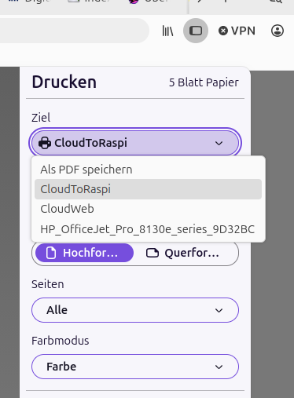
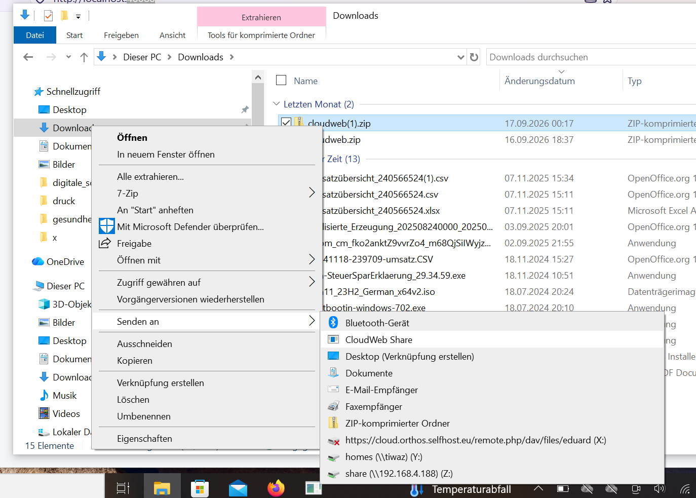
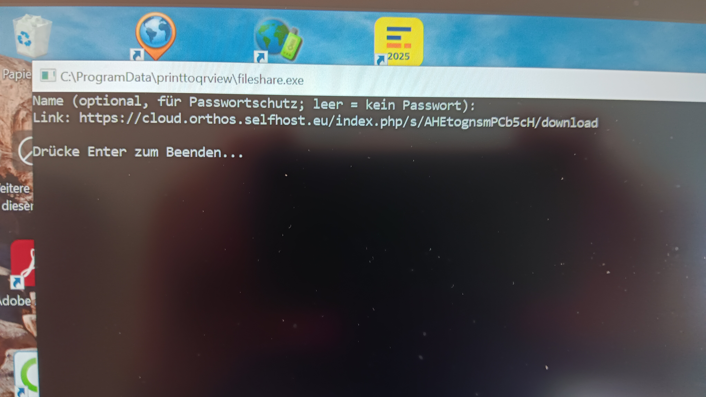
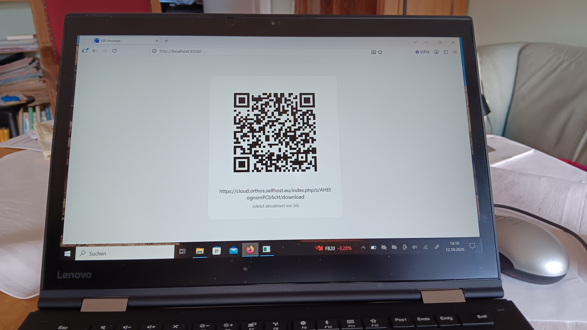

<section>
<nav>
<ul>
  <li><a href="index.html">← Overview</a></li>
  

  <li><a href="#sec-printing">Printing a file</a></li>
  <li><a href="#sec-result">Seeing the result</a></li>
  <li><a href="#sec-windows-send">Windows: Explorer "Send to"</a></li>
  <li><a href="#sec-no-printer">Sharing without a printer</a></li>
  <li><a href="#sec-password">Password-protected shares</a></li>
  

  <li><a href="installation.html">Installation</a></li>
  <li><a href="software-details.html">Software details</a></li>
</ul>
</nav>

<article markdown="1">

# Usage

## Printing a file {#sec-printing}

With the CUPS queues set up (see [Installation](installation.html)), any
application's print dialog can target `CloudToRaspi` (shows the result on
a Raspberry Pi display) or `CloudWeb` (shows the result in a browser) like
any other printer:

{: width="500"}

The same two queues can also be used without a print dialog, via
`scripts/share.sh path/to/file` (defaults to `CloudToRaspi`,
`PRINTER=CloudWeb scripts/share.sh ...` to pick the other) or
`scripts/share-to-web.sh path/to/file` (always `CloudWeb`).

## Seeing the result {#sec-result}

On `CloudWeb`, the QR code and link show up in a browser tab left open on
`cloudweb`'s page - any device on the LAN, including a phone:

{: width="500"}

On `CloudToRaspi`, the same QR code and link show up on the attached
Raspberry Pi display:

{: width="500"}

Either way, the link also always gets logged (see
`/var/lib/myshare/tmp/links.log` for the CUPS backend), so the display is
a convenience, not the only way to retrieve the link.

## Windows: Explorer "Send to" {#sec-windows-send}

After installing the Windows "Send to" entry (see
[Installation: Windows](installation.html#sec-windows)), right-click any
file and choose "Send to" → "CloudWeb Share":

{: width="500"}

A console window opens, optionally asks for a name (for password
protection, see below), and then prints the resulting share link:

{: width="500"}

If a `cloudweb` instance is running on the same machine, the QR code also
shows up there automatically:

{: width="500"}

## Sharing without a printer {#sec-no-printer}

- `sendfile path/to/file` - same upload+share+QR flow, directly from the
  command line, no CUPS queue needed.
- `webshare` - an HTTP entry point so, e.g., a phone on the network can
  trigger the same flow without its own Nextcloud credentials (see
  [Installation: Android / Termux](installation.html#sec-android) for the
  recommended setup).
- Dragging a file onto the Explorer "Send to" entry on Windows
  (`fileshare.exe`, see above).

## Password-protected shares {#sec-password}

`scripts/share-to-web.sh path/to/file Name` (or the Windows `fileshare`
tool, which prompts for the name interactively) additionally protects the
share with a Nextcloud share password. The recipient needs both the
`Name` and a short code shown next to the link/QR code to derive the real
password - without a name argument, the share stays unprotected as
before. See the
[README section "Sharing arbitrary files via the CUPS queue"](https://github.com/fritzthekid/myshare/blob/main/README.md#sharing-arbitrary-files-via-the-cups-queue-scriptssharesh)
and `internal/sharepassword` for how the password is derived.

</article>
</section>
