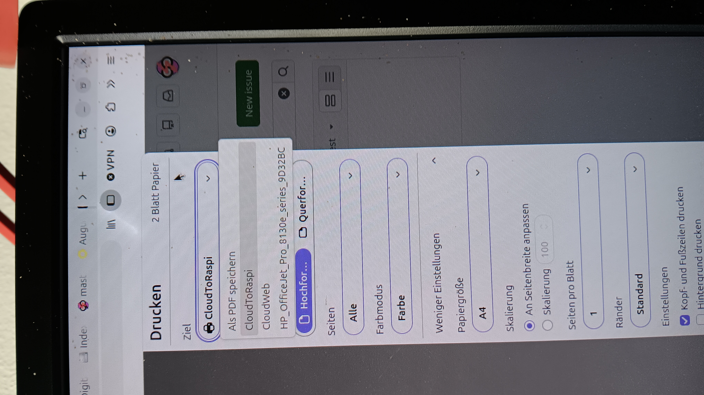
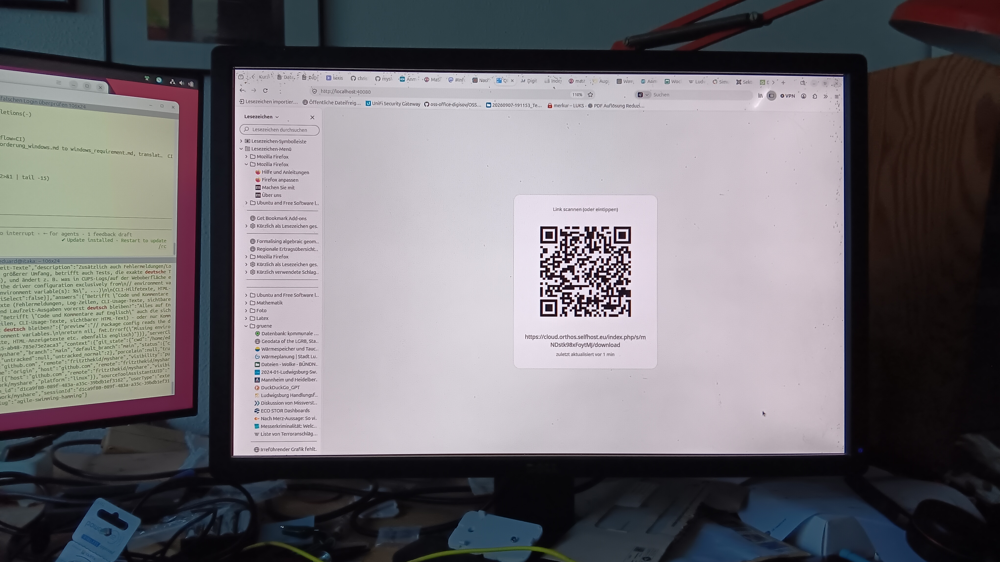
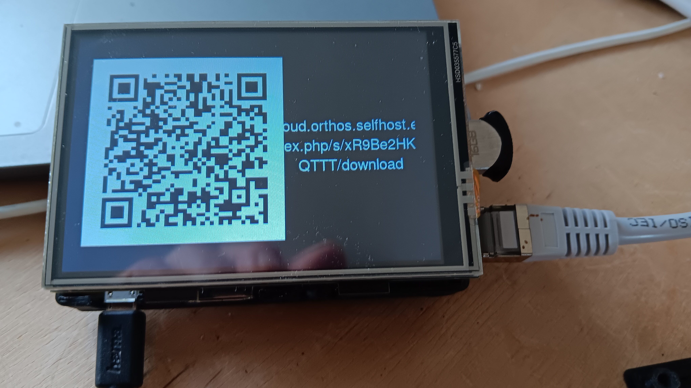

[← Back to overview](index.md)

# Usage

## Printing a file

With the CUPS queues set up (see [Installation](installation.md)), any
application's print dialog can target `CloudToRaspi` (shows the result on
a Raspberry Pi display) or `CloudWeb` (shows the result in a browser) like
any other printer:

The same two queues can also be used without a print dialog, via
`scripts/share.sh path/to/file` (defaults to `CloudToRaspi`,
`PRINTER=CloudWeb scripts/share.sh ...` to pick the other) or
`scripts/share-to-web.sh path/to/file` (always `CloudWeb`).

## Seeing the result

On `CloudWeb`, the QR code and link show up in a browser tab left open on
`cloudweb`'s page - any device on the LAN, including a phone:

On `CloudToRaspi`, the same QR code and link show up on the attached
Raspberry Pi display:

Either way, the link also always gets logged (see
`/var/lib/myshare/tmp/links.log` for the CUPS backend), so the display is a
convenience, not the only way to retrieve the link.

## Sharing without a printer

- `sendfile path/to/file` - same upload+share+QR flow, directly from the
  command line, no CUPS queue needed.
- `webshare` - an HTTP entry point so, e.g., a phone on the network can
  trigger the same flow without its own Nextcloud credentials (see
  [Installation](installation.md) for the recommended Termux setup).
- Dragging a file onto the Explorer "Send to" entry on Windows
  (`fileshare.exe`).

## Password-protected shares

`scripts/share-to-web.sh path/to/file Name` (or the Windows `fileshare`
tool, which prompts for the name interactively) additionally protects the
share with a Nextcloud share password. The recipient needs both the
`Name` and a short code shown next to the link/QR code to derive the real
password - without a name argument, the share stays unprotected as before.
See the
[README section "Sharing arbitrary files via the CUPS queue"](https://github.com/fritzthekid/myshare/blob/main/README.md#sharing-arbitrary-files-via-the-cups-queue-scriptssharesh)
and `internal/sharepassword` for how the password is derived.
